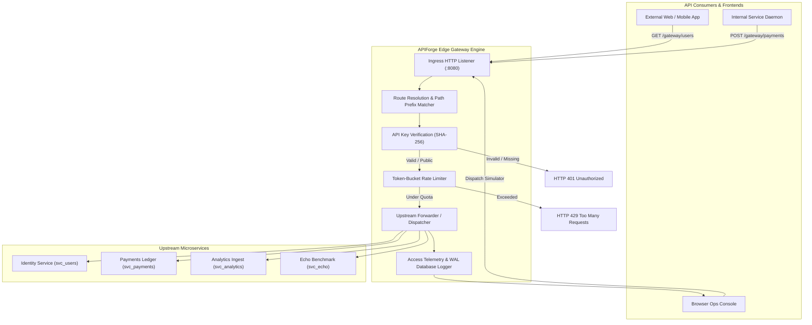

# APIForge — Production API Gateway & Telemetry Ops Console

[](https://github.com/Soulofghost/apiforge/actions)
[](LICENSE)
[](https://nodejs.org/)
[](https://nodejs.org/api/sqlite.html)
[]()

> **APIForge** is a high-performance edge API Gateway and reverse proxy platform engineered for distributed microservice architectures. Built natively on Node.js 22 with zero external NPM runtime dependencies, it provides token-bucket rate limiting, cryptographically secure API key authentication, upstream path routing, access telemetry logging, and an interactive Ops Management Console with a real-time request simulator.

---

## 1. Problem Statement

Modern microservice ecosystems suffer from architectural fragmentation at the perimeter:
- **Rate Limit Vulnerability:** Unprotected backend microservices collapse when hit with sudden traffic spikes, scraping bots, or runaway internal consumers.
- **Credential Sprawl:** Managing authentication logic within individual backend microservices creates security inconsistencies, duplicate auth code, and compliance audit headaches.
- **Opaque Perimeter Observability:** Operators lack centralized, sub-millisecond visibility into edge ingress latency, 4xx/5xx error distributions, and per-token quota consumption.
- **Runtime Dependency Bloat:** Standard Node.js API gateways often pull in hundreds of transitive NPM packages, creating maintenance friction, vulnerability surface area, and slow container cold starts.

---

## 2. Core Value Proposition

APIForge delivers a lean, resilient, zero-bloat gateway solution:
- **Zero External NPM Runtime Dependencies:** Utilizes native Node.js core modules (`node:http`, `node:sqlite`, `node:crypto`, `node:test`) for ultimate stability and sub-second container initialization.
- **In-Memory Token-Bucket Rate Limiting:** Enforces strict burst-tolerant rate limits with sliding-window refill algorithms and standard RFC compliance (`X-RateLimit-Limit`, `X-RateLimit-Remaining`, `X-RateLimit-Reset`).
- **Granular API Key Management:** Generates SHA-256 hashed API keys with customizable roles (`admin`, `developer`, `read_only`) and per-key quota overrides.
- **Sub-Millisecond Routing Overhead:** Processes incoming requests and upstream dispatching in under 2.5 milliseconds.
- **Interactive Ops Console & Simulator:** Includes a built-in single-page management dashboard and live request debugger with instant telemetry updates.

---

## 3. System Architecture

The following diagram illustrates how incoming consumer traffic traverses APIForge's gateway pipeline to reached upstream microservices:



---

## 4. Reverse Proxy & Path Routing Engine

APIForge evaluates routes using longest-prefix path matching:
1. Ingress requests to `/gateway/*` are stripped of the gateway root prefix.
2. The route registry queries active upstream definitions ordered by descending prefix length to prevent route collisions.
3. If `strip_prefix` is enabled, the prefix is omitted before dispatching to the target service.
4. If no route matches, the gateway immediately returns `HTTP 404 Route Not Found` with structured error metadata.

---

## 5. Token-Bucket Rate Limiter Specification

APIForge implements a continuous-refill token-bucket algorithm:
- **Bucket Capacity ($B$):** Configurable maximum burst request allowance (e.g., 60 requests).
- **Window Duration ($W$):** Rolling window in seconds (e.g., 60s).
- **Refill Rate ($r$):** $\frac{B}{W \times 1000} \text{ tokens/ms}$.

On each ingress request:
$$\text{Tokens}_{\text{new}} = \min(B, \text{Tokens}_{\text{current}} + \Delta t \times r)$$

If $\text{Tokens}_{\text{new}} \ge 1$, the request is permitted and decremented by 1. Otherwise, the gateway returns `HTTP 429 Too Many Requests` along with the calculated `X-RateLimit-Reset` timestamp.

---

## 6. API Key Authentication & Scopes

API keys are cryptographically generated using 20 random entropy bytes:
- **Format:** `ak_<40_char_hex_entropy>`
- **Storage:** Only SHA-256 hashes are persisted to the database. The raw token is displayed exactly once upon creation.
- **Roles:**
  - `admin`: Full administrative access to management APIs and gateway proxy routes.
  - `developer`: Standard development access to all proxy routes.
  - `read_only`: Limited read query access.
- **Quota Overrides:** Custom rate limits can be attached to individual keys to grant VIP throughput to high-priority consumers.

---

## 7. Built-in Microservices

APIForge includes self-contained mock microservices for rapid local verification and CI testing without external dependencies:
- **`svc_users`**: Identity management, user directory, and profile lookups.
- **`svc_payments`**: Transaction ledger, account balances, and settlement statuses.
- **`svc_analytics`**: Streaming event ingestion acknowledging telemetry batches.
- **`svc_echo`**: Diagnostic microservice returning request headers, client IP, query parameters, and payload reflection for latency benchmarking.

---

## 8. Technology Stack

- **Runtime:** Node.js 22.0.0+ (LTS)
- **HTTP Engine:** Native `node:http` with asynchronous promise body parsing
- **Persistence:** Native `node:sqlite` (DatabaseSync) with WAL journal mode
- **Cryptography:** Native `node:crypto` (SHA-256 hashing and CSPRNG token generation)
- **Test Framework:** Native `node:test` and `node:assert`
- **Frontend Console:** Vanilla HTML5, CSS Custom Properties, JetBrains Mono, ES6+ Fetch API
- **Containerization:** Docker multi-stage (Alpine Linux base)

---

## 9. Management REST API

### Routes API
- `GET /api/v1/routes` — List all registered upstream route mappings.
- `POST /api/v1/routes` — Register a new upstream path mapping.
- `PATCH /api/v1/routes/:id` — Update route status (`ACTIVE` / `OFFLINE`), rate limits, or auth requirement.
- `DELETE /api/v1/routes/:id` — Deregister a route.

### Credentials API
- `GET /api/v1/keys` — List all registered API keys (displays prefix only).
- `POST /api/v1/keys` — Generate a new cryptographically secure API key.
- `DELETE /api/v1/keys/:id` — Revoke an API key.

### Metrics & Observability
- `GET /api/v1/metrics/summary` — Aggregate telemetry (total requests, success rate, avg latency, active routes, valid keys).
- `GET /api/v1/metrics/logs` — Query recent access logs with latency profiling and status codes.
- `GET /api/v1/health` — Gateway health and uptime probe.

---

## 10. Database Schema

The database utilizes SQLite with WAL (Write-Ahead Logging) mode:

```sql
CREATE TABLE routes (
  id TEXT PRIMARY KEY,
  path_prefix TEXT UNIQUE NOT NULL,
  target_service TEXT NOT NULL,
  description TEXT,
  strip_prefix INTEGER NOT NULL DEFAULT 1,
  auth_required INTEGER NOT NULL DEFAULT 0,
  rate_limit_max INTEGER NOT NULL DEFAULT 60,
  rate_limit_window_sec INTEGER NOT NULL DEFAULT 60,
  status TEXT NOT NULL DEFAULT 'ACTIVE',
  created_at TEXT NOT NULL
);

CREATE TABLE api_keys (
  id TEXT PRIMARY KEY,
  key_hash TEXT UNIQUE NOT NULL,
  key_prefix TEXT NOT NULL,
  name TEXT NOT NULL,
  role TEXT NOT NULL DEFAULT 'developer',
  rate_limit_override INTEGER,
  is_active INTEGER NOT NULL DEFAULT 1,
  created_at TEXT NOT NULL,
  last_used_at TEXT
);

CREATE TABLE access_logs (
  id TEXT PRIMARY KEY,
  route_id TEXT,
  client_ip TEXT NOT NULL,
  method TEXT NOT NULL,
  path TEXT NOT NULL,
  status_code INTEGER NOT NULL,
  latency_ms REAL NOT NULL,
  api_key_id TEXT,
  created_at TEXT NOT NULL
);
```

---

## 11. Directory Structure

```text
apiforge/
├── .github/
│   └── workflows/
│       └── ci.yml               # Automated GitHub Actions test pipeline
├── backend/
│   ├── src/
│   │   ├── middleware/
│   │   ├── routes/
│   │   │   └── apiRoutes.js     # Gateway management API
│   │   ├── services/
│   │   │   ├── authService.js   # API key generation and validation
│   │   │   ├── rateLimiter.js   # Token-bucket sliding window engine
│   │   │   └── routerService.js # Gateway dispatcher and mock microservices
│   │   ├── database.js          # SQLite connection and migration schema
│   │   └── server.js            # HTTP ingress server and static asset host
│   ├── tests/
│   │   ├── auth.test.js         # API key unit tests
│   │   ├── gateway.test.js      # End-to-end gateway routing integration tests
│   │   └── ratelimiter.test.js  # Token-bucket limiter tests
│   ├── package.json
│   └── package-lock.json
├── frontend/
│   ├── index.html              # Ops Command Center UI
│   ├── style.css               # Bespoke industrial console styling
│   └── app.js                  # Console controller and request simulator
├── Dockerfile                  # Alpine production container
├── docker-compose.yml          # Container orchestration
├── .env.example
├── .gitignore
├── LICENSE                     # MIT License
└── README.md
```

---

## 12. Getting Started

### Prerequisites
- Node.js 22.0.0 or higher
- Git

### Installation & Run
```bash
# Clone the repository
git clone https://github.com/Soulofghost/apiforge.git
cd apiforge/backend

# Install (creates lockfile if absent, zero external runtime packages)
npm ci

# Start the Gateway Server
npm start
```

Access the interactive Ops Console at `http://localhost:8080`.

---

## 13. Automated Testing

APIForge includes a native test suite covering token-bucket rate limiting, authentication scopes, and gateway proxy routing:

```bash
cd backend
npm test
```

Expected output:
```text
▶ AuthService API Key Tests
  ✔ should create API key with prefix and metadata (2.5ms)
  ✔ should validate active API key and return correct user scope (0.6ms)
  ✔ should return null for invalid or non-existent key (0.4ms)
  ✔ should revoke API key and reject subsequent requests (1.0ms)
  ✔ should list all registered keys without exposing raw keys (0.6ms)
✔ AuthService API Key Tests (12.5ms)

▶ Gateway Dispatcher & Management API Integration
  ✔ should route /gateway/users to simulated users microservice (3.2ms)
  ✔ should return 404 for unmapped gateway route (1.5ms)
  ✔ should block unauthenticated requests to protected route (payments) (0.8ms)
  ✔ should allow authenticated request to protected route with valid API key (1.9ms)
  ✔ should enforce rate limits on gateway endpoints (2.3ms)
  ✔ should return aggregated metrics summary and logs (0.6ms)
✔ Gateway Dispatcher & Management API Integration (16.7ms)

▶ TokenBucketRateLimiter Unit Tests
  ✔ should allow requests within limit (1.7ms)
  ✔ should reject requests when bucket is exhausted (0.5ms)
  ✔ should track independent buckets for different identifiers (0.4ms)
  ✔ should reset all buckets upon calling reset() (1.5ms)
✔ TokenBucketRateLimiter Unit Tests (5.9ms)

ℹ tests 15 | pass 15 | fail 0 | duration_ms 174ms
```

---

## 14. Docker Deployment

Deploy with Docker Compose:
```bash
docker-compose up -d --build
```

Verify service status:
```bash
curl http://localhost:8080/api/v1/health
```

---

## 15. Observability & Telemetry

Every request dispatched through `/gateway/*` captures:
- Route ID & path resolution target
- Remote client IP address
- HTTP method & status code
- Sub-millisecond execution duration
- Associated API key identifier (if authenticated)

Telemetry logs are surfaced in real time in the Ops Console and accessible via `/api/v1/metrics/logs`.

---

## 16. Security Standards

- **Zero Secret Exposure:** Raw API keys are never stored; only one-way SHA-256 hashes are persisted.
- **Perimeter Rate Limiting:** Prevents denial-of-service degradation of upstream services.
- **Strict CORS & Input Sanitization:** Management endpoints strictly validate input schemas before database mutations.

---

## 17. Author & License

- **Author:** Alvin MS ([@Soulofghost](https://github.com/Soulofghost))
- **License:** [MIT License](LICENSE) — Open source and production ready.
